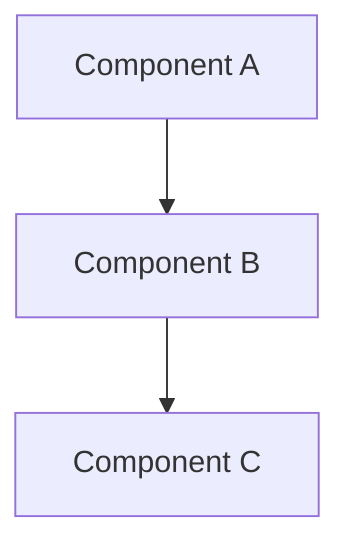

# 📚 Documentation Maintenance Guide

**Project**: Visual Home Inventory Manager
**Last Updated**: November 26, 2025
**Version**: 1.0
**Status**: ACTIVE - Keep Updated

---

## Overview

This guide establishes the documentation strategy for the Visual Home Inventory Manager project. All developers and AI assistants should follow this guide to maintain accurate, current documentation.

---

## 📋 Documentation Structure

### Primary Documentation (ALWAYS KEEP UPDATED)

1. **README.md** ⭐ MAIN REFERENCE
   - Quick start and installation
   - System architecture with diagrams
   - Project structure overview
   - Key features summary
   - API endpoints reference
   - Testing overview
   - Development workflows
   - Deployment guide
   - Troubleshooting section
   - Project status and metrics

2. **CLAUDE.md** - DETAILED TECHNICAL REFERENCE
   - In-depth architecture patterns
   - Code style standards
   - Detailed command reference
   - Debugging tips
   - Environment configuration
   - Performance considerations
   - Common development patterns
   - Service descriptions

3. **GEMINI.md** - OPTIONAL GEMINI-SPECIFIC REFERENCE
   - Keep if using Gemini API
   - Similar structure to CLAUDE.md
   - Gemini-specific patterns

### Supporting Documentation (REFERENCE ONLY)

- `PHASE_5C_COMPLETION_REPORT.md` - Phase completion status
- `FINAL_DELIVERABLES_SUMMARY.md` - Project summary
- Test files - Contain working examples
- Commit history - Track changes over time

---

## 📝 When to Update Documentation

### ✅ MUST UPDATE (Do Not Skip)

1. **After implementing new features**
   - Add to "Key Features" section
   - Update project structure if new directories created
   - Update API endpoints if new routes added

2. **When adding/modifying API endpoints**
   - Update "API Endpoints" section in README
   - Document request/response formats
   - Update CLAUDE.md with detailed examples

3. **When changing architecture**
   - Update architecture diagrams
   - Update project structure sections
   - Document new patterns in CLAUDE.md

4. **When fixing critical bugs**
   - Add solution to Troubleshooting section
   - Update CLAUDE.md if pattern-related
   - Document root cause

5. **When updating dependencies**
   - Update version numbers in README prerequisites
   - Document breaking changes in CLAUDE.md
   - Note any migration steps needed

### ⚠️ SHOULD UPDATE

1. After completing testing phases
2. When changing code standards
3. After performance improvements
4. When discovering new best practices
5. Before major releases/milestones

---

## 🔧 How to Update Documentation

### Step 1: Identify What Changed
```bash
# Review your git diff
git diff --stat

# See detailed changes
git diff

# Check what you modified
git status
```

### Step 2: Update Relevant Sections

#### For Feature Implementation
```markdown
# In README.md - "Key Features" section:
- ✅ **New Feature Name** - Brief description

# In README.md - "Project Structure":
├── new-directory/          # What it contains
│   └── new-file.ts         # What this file does

# In CLAUDE.md:
## New Feature Implementation
- How to use it
- Code examples
- Best practices
```

#### For API Endpoint Changes
```markdown
# In README.md - "API Endpoints" section:
POST   /v1/new-endpoint     # What it does
```
Get/POST/PUT/DELETE depending on HTTP method

#### For Bug Fixes
```markdown
# In README.md - "Troubleshooting" section:
### Issue: [Clear description]
```bash
# How to reproduce
# Solution
# Root cause explanation
```
```

### Step 3: Update Project Status

```markdown
# In README.md - "Project Status" section:
Update metrics:
- Code lines count (if significant changes)
- Test count (if new tests added)
- Coverage percentage (if tests changed)

Update dates:
- "Last Updated": [Current Date]
```

### Step 4: Commit with Documentation

```bash
# Standard commit message format:
git commit -m "feat: Add new feature description

- Brief summary of feature
- Update documentation for:
  - README.md sections changed
  - CLAUDE.md additions
  - New troubleshooting tips if applicable

🤖 Generated with Claude Code
Co-Authored-By: Claude <noreply@anthropic.com>"
```

---

## 📐 Documentation Standards

### Content Standards
- **Concise**: Get to the point quickly
- **Precise**: Exact details, no vague language
- **Current**: Always up-to-date with code
- **Examples**: Include working code examples
- **Organized**: Clear headings and sections

### Format Standards

**Headings Hierarchy:**
```markdown
# Main Title (H1) - Only one per file
## Major Sections (H2)
### Subsections (H3)
#### Details (H4)
```

**Code Examples:**
```markdown
# Bad - No language specified
```
command here
```

# Good - Always specify language
```bash
# This is a bash command
npm run dev
```

# For code snippets
```typescript
// TypeScript code
const value: string = "example";
```
```

**Status Indicators:**
```markdown
✅ Completed/Working
⚠️  In Progress/Warning
❌ Failed/Not Working
🔄 In Development
⏳ Pending/Planned
```

### Diagram Standards

**Use Mermaid for:**
- System architecture
- Data flows
- Sequence diagrams
- Relationship diagrams

**Example:**


---

## 🚀 Common Update Scenarios

### Scenario 1: Adding a New API Endpoint

**Files to Update:**
1. README.md - Add to "API Endpoints" section
2. CLAUDE.md - Add detailed example
3. Code commit message - Reference endpoints

**Example Update:**
```markdown
# In README.md

### New Endpoint Name
```http
POST /v1/new-endpoint
Content-Type: application/json

{
  "param": "value"
}
```

Response:
```json
{
  "success": true,
  "result": {...}
}
```
```

### Scenario 2: Fixing a Bug

**Files to Update:**
1. README.md - Add to "Troubleshooting"
2. CLAUDE.md - Add to relevant section
3. Commit message - Explain fix

**Example Update:**
```markdown
# In README.md - Troubleshooting

### API Server Returns 500 Error on Image Upload
```bash
# Issue: Rate limiting was too strict
# Solution: Check rate limit config in src/app.ts
# Was set to: 10 req/min
# Changed to: 100 req/min

# To fix:
npm run dev
```
```

### Scenario 3: Performance Improvement

**Files to Update:**
1. README.md - Update "Project Status" metrics
2. CLAUDE.md - Update "Performance Considerations"
3. Commit message - Explain improvement

**Example Update:**
```markdown
# In README.md - Project Status

API Performance:
├── Detection:      <250ms processing time    # Was 500ms
├── Accuracy:       87-88% average confidence
└── Throughput:     100+ detections/second    # Was 50/second
```

---

## ✅ Documentation Maintenance Checklist

### Before Every Commit

- [ ] README.md reflects current status
- [ ] CLAUDE.md has relevant examples
- [ ] Project structure is accurate
- [ ] Test coverage numbers updated
- [ ] API endpoints documented
- [ ] Prerequisites section current
- [ ] Troubleshooting section includes new issues

### Weekly Review

- [ ] Scan recent commits
- [ ] Check for undocumented changes
- [ ] Update any outdated sections
- [ ] Verify code examples still work
- [ ] Check for new best practices

### Monthly Review

- [ ] Comprehensive documentation audit
- [ ] Update metrics if significant changes
- [ ] Review troubleshooting section
- [ ] Update "What's Next" section
- [ ] Ensure diagrams are accurate

### Before Each Release

- [ ] Complete comprehensive documentation review
- [ ] Update version numbers
- [ ] Document all new features
- [ ] Update deployment section
- [ ] Create release notes summary

---

## 🔍 Quality Checklist for Documentation Updates

### Accuracy
- [ ] Information matches actual code
- [ ] Examples are tested/working
- [ ] URLs and links are valid
- [ ] Version numbers are current
- [ ] Code samples follow project style

### Completeness
- [ ] All new features documented
- [ ] All endpoints documented
- [ ] Architecture clearly explained
- [ ] Examples provided for complex features
- [ ] Troubleshooting covers common issues

### Clarity
- [ ] Language is clear and concise
- [ ] Technical terms are explained
- [ ] Structure is logical
- [ ] Headings are descriptive
- [ ] Formatting is consistent

### Maintainability
- [ ] Documentation is easy to update
- [ ] Changes are tracked in git
- [ ] Related docs are cross-referenced
- [ ] Standard format is followed
- [ ] Outdated info is removed

---

## 📊 Documentation Update Statistics

### Current Status (November 26, 2025)

```
Primary Documentation:
├── README.md         696 lines (Comprehensive)
├── CLAUDE.md         327 lines (Technical reference)
└── GEMINI.md         [Optional]

Supporting Documentation:
├── PHASE_5C_COMPLETION_REPORT.md    (600 lines)
├── FINAL_DELIVERABLES_SUMMARY.md    (481 lines)
└── Test files with examples          (2000+ lines)

Total Documentation: 2,200+ lines
Last Updated: November 26, 2025
Update Frequency: After each significant change
Maintenance Status: ACTIVE
```

---

## 🎯 Best Practices

### DO ✅

1. Update README immediately after changes
2. Use consistent formatting
3. Include working code examples
4. Keep diagrams current
5. Reference file paths accurately
6. Update version numbers
7. Test all documented commands
8. Cross-reference related sections
9. Use status indicators
10. Commit documentation changes

### DON'T ❌

1. Leave outdated information
2. Use vague language
3. Include non-working examples
4. Over-elaborate simple concepts
5. Ignore documentation standards
6. Forget to update version numbers
7. Skip code example testing
8. Break cross-references
9. Use inconsistent formatting
10. Commit code without doc updates

---

## 🔗 Cross-Reference Guide

### When to Link to Other Sections

**Link when:**
- Referencing setup instructions → Quick Start
- Referring to architecture → System Architecture
- Discussing patterns → CLAUDE.md
- Explaining features → Key Features
- Showing how to use → Development Workflow
- Fixing issues → Troubleshooting

**Link Format:**
```markdown
See [Section Name](#section-name) for details
```

---

## 📞 Documentation Questions?

**Common Questions:**

**Q: How often should I update?**
A: After every feature or significant change. At minimum, weekly review.

**Q: What if I'm not sure what to document?**
A: If you changed code, document it. If users would care, it belongs in README.

**Q: Should I update CLAUDE.md?**
A: Yes, if the change affects technical implementation details or patterns.

**Q: How detailed should examples be?**
A: Detailed enough that a developer could use them immediately.

**Q: What about old documentation?**
A: Remove outdated information. Don't leave confusing legacy docs.

---

## 🎓 Quick Reference

### Files to Update When...

```
┌─ Adding Feature
│  ├─ README.md: Key Features section
│  ├─ README.md: Project Structure (if new files)
│  └─ CLAUDE.md: Implementation details
│
├─ Adding API Endpoint
│  ├─ README.md: API Endpoints section
│  └─ CLAUDE.md: Detailed example
│
├─ Fixing Bug
│  ├─ README.md: Troubleshooting section
│  └─ CLAUDE.md: Pattern/best practice
│
├─ Improving Performance
│  ├─ README.md: Metrics section
│  └─ CLAUDE.md: Performance section
│
└─ Updating Dependencies
   ├─ README.md: Prerequisites section
   └─ CLAUDE.md: Code examples
```

---

## 🚀 Getting Started with Updates

**When you make code changes:**

1. Finish implementing the feature/fix
2. Test it thoroughly
3. Identify what changed
4. Update README.md primary sections
5. Update CLAUDE.md if appropriate
6. Test documented commands
7. Commit with documentation note
8. Done!

---

**Remember: Good documentation is the best gift to future developers (including yourself!).**

Last Updated: November 26, 2025
Maintenance Status: ✅ ACTIVE
