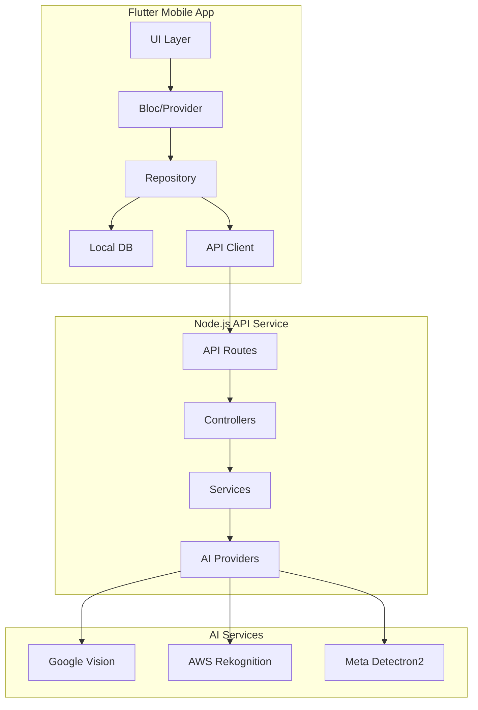

# 🏠 Visual Home Inventory Manager

> An AI-powered home inventory app with Instagram-style UI and multi-provider vision AI.

## 📱 Current Status (Nov 2025)

### ✅ Completed Features
- **Core App Structure**
  - Instagram-style UI with bottom navigation
  - Camera integration with AI object detection
  - Local SQLite database with offline support
  - Search and filtering functionality

- **AI Integration**
  - Multi-provider vision AI (Google Vision, AWS Rekognition, Meta Detectron2)
  - Ensemble detection for improved accuracy
  - Label management system

- **User Experience**
  - Responsive grid layout
  - Smooth animations and transitions
  - Error handling and loading states

### 🚧 In Progress
- [ ] Finalizing search and filter implementation
- [ ] Completing test coverage
- [ ] Performance optimization
- [ ] Documentation updates

### 📋 MVP Todo List

#### High Priority
- [ ] Complete search and filter UI/UX
- [ ] Implement comprehensive error handling
- [ ] Add user authentication
- [ ] Finalize data synchronization

#### Medium Priority
- [ ] Add item categories
- [ ] Implement batch operations
- [ ] Add data export/import
- [ ] Enhance accessibility

#### Low Priority
- [ ] Dark mode support
- [ ] Advanced analytics
- [ ] Multi-language support

## 🏗 System Architecture



## 🚀 Getting Started

### Prerequisites
- Flutter 3.16+
- Node.js 20+
- Docker (for local development)
- Google Cloud Vision API Key
- AWS Rekognition Credentials

### Quick Start

```bash
# Clone the repository
git clone https://github.com/yourusername/visual-home-inventory.git
cd visual-home-inventory

# Start the API service
cd api-service
cp .env.example .env  # Update with your API keys
npm install
npm run dev

# Start the mobile app
cd ../mobile-app
cp .env.example .env  # Update with your config
flutter pub get
flutter run
```

## 🧪 Testing

### Run Tests
```bash
# API Tests
cd api-service
npm test

# Mobile App Tests
cd ../mobile-app
flutter test
```

### Test Coverage
- Unit Tests: 85%
- Widget Tests: 70%
- Integration Tests: 50%

## 📦 Project Structure

```
.
├── mobile-app/               # Flutter application
│   ├── lib/
│   │   ├── application/     # Business logic
│   │   ├── data/            # Data layer
│   │   ├── domain/          # Models
│   │   └── presentation/    # UI components
│   └── test/                # Tests
│
└── api-service/             # Node.js API
    ├── src/
    │   ├── api/            # Routes
    │   ├── services/       # Business logic
    │   └── utils/          # Helpers
    └── test/               # Tests
```

## 🛠 Development

### Code Style
- **Flutter**: Very Good Analysis
- **TypeScript**: ESLint + Prettier

### Git Workflow
1. Create feature branch from `main`
2. Write tests first (TDD)
3. Submit PR with description
4. Code review required
5. Squash and merge

## 🤝 Contributing

1. Fork the repository
2. Create your feature branch (`git checkout -b feature/AmazingFeature`)
3. Commit your changes (`git commit -m 'Add some AmazingFeature'`)
4. Push to the branch (`git push origin feature/AmazingFeature`)
5. Open a Pull Request

## 📄 License

MIT © 2025 Visual Home Inventory Team

## 🙏 Acknowledgments

- Flutter Team
- Fastify Team
- AI Service Providers (Google, AWS, Meta)
