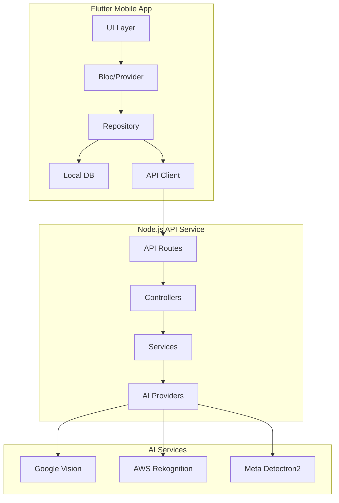
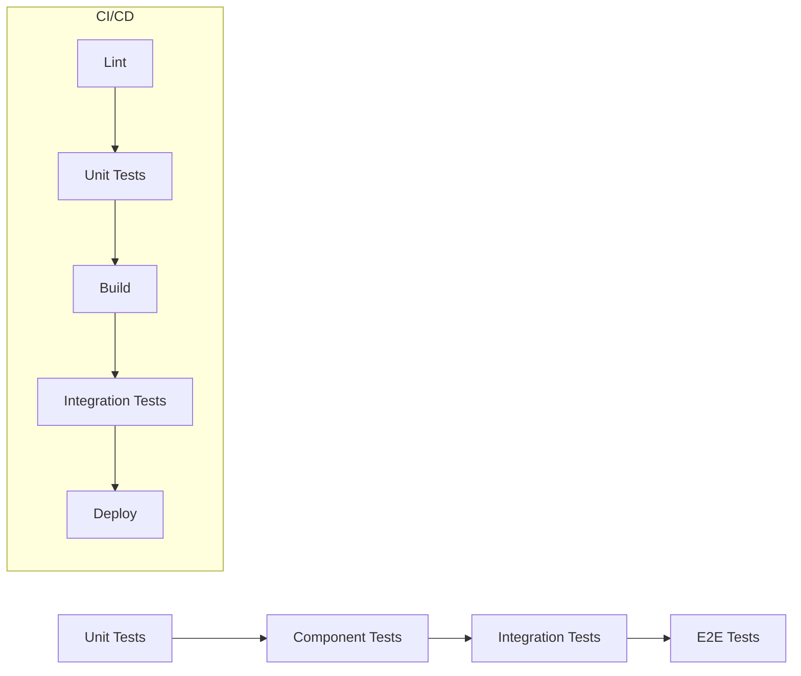

# 🏠 Visual Home Inventory Manager

> An AI-powered home inventory app with Instagram-style UI and multi-provider vision AI.

## 🏗 System Architecture



## 🧩 Core Components

### 1. Mobile App (`/mobile-app`)
- **Tech Stack**: Flutter 3.16+, Riverpod, Drift ORM
- **Key Features**:
  - 📸 Camera integration
  - 🏠 Home inventory management
  - 🔍 AI-powered search
  - 📱 Offline-first architecture

### 2. API Service (`/api-service`)
- **Tech Stack**: Node.js 20+, Fastify, TypeScript
- **Key Features**:
  - 🔐 JWT Authentication
  - 🤖 Multi-provider AI integration
  - ⚡ High-performance image processing
  - 📊 Analytics and metrics

## 🚀 Getting Started

### Prerequisites
- Flutter 3.16+
- Node.js 20+
- Docker (for local development)

### Quick Start

```bash
# Clone the repository
git clone https://github.com/yourusername/visual-home-inventory.git
cd visual-home-inventory

# Start the API service
cd api-service
npm install
npm run dev

# Start the mobile app
cd ../mobile-app
flutter pub get
flutter run
```

## 🧪 Testing Strategy



## 📂 Project Structure

```
.
├── mobile-app/               # Flutter application
│   ├── lib/
│   │   ├── application/     # Business logic
│   │   ├── data/            # Data layer
│   │   ├── domain/          # Models
│   │   └── presentation/    # UI components
│   └── test/                # Tests
│
└── api-service/             # Node.js API
    ├── src/
    │   ├── api/            # Routes
    │   ├── services/       # Business logic
    │   └── utils/          # Helpers
    └── test/               # Tests
```

## 🛠 Development

### Code Style
- **Flutter**: Very Good Analysis
- **TypeScript**: ESLint + Prettier

### Git Workflow
1. Create feature branch from `main`
2. Write tests first (TDD)
3. Submit PR with description
4. Code review required
5. Squash and merge

## 📄 License

MIT © 2025 Visual Home Inventory Team
