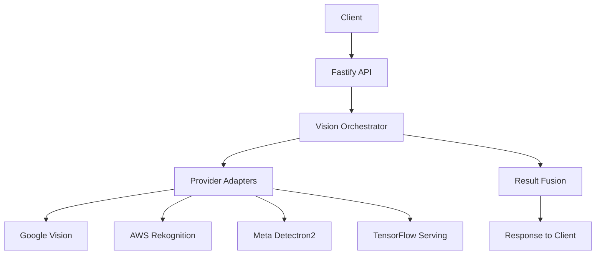

# 🚀 Vision AI API Service

> Ensemble vision AI proxy service for the Visual Home Inventory Manager.

## 🌟 Features

- **Multi-provider AI Vision** - Combines multiple AI providers for accurate object detection
- **Fault Tolerance** - Circuit breaker pattern for graceful degradation
- **High Performance** - Parallel execution of detection providers
- **Smart Result Fusion** - Advanced algorithms for combining results
- **Production Ready** - Structured logging, metrics, and health checks

## 🏗 Architecture



### Core Components

1. **API Layer** - Fastify-based REST API with request validation
2. **Orchestrator** - Manages parallel execution and result aggregation
3. **Provider Adapters** - Standardized interfaces for different AI providers
4. **Fusion Engine** - Combines results using NMS and confidence weighting
5. **Circuit Breakers** - Prevents cascading failures from provider issues

## 🛠 Tech Stack

| Category        | Technologies                          |
|-----------------|---------------------------------------|
| Runtime         | Node.js 20 LTS                        |
| Language        | TypeScript 5.x                        |
| Web Framework   | Fastify 4.x                           |
| AI Providers    | Google Vision, AWS Rekognition        |
| Testing         | Vitest, Supertest                     |
| Documentation   | OpenAPI/Swagger                       |
| Container       | Docker                                |
| CI/CD           | GitHub Actions                        |
| Monitoring      | Prometheus, Grafana                   |
| Logging         | Pino                                  |
| Configuration   | dotenv                                |
| Validation      | Zod                                   |

## 🚀 Getting Started

### Prerequisites

- Node.js 20 LTS
- npm 10+ or pnpm 8+
- Google Cloud Platform account with Vision API enabled
- (Optional) AWS account with Rekognition access

### Installation

1. **Clone the repository**
   ```bash
   git clone https://github.com/yourusername/visual-home-inventory.git
   cd visual-home-inventory/api-service
   ```

2. **Install dependencies**
   ```bash
   npm install
   # or
   pnpm install
   ```

3. **Configure environment**
   ```bash
   cp .env.example .env
   # Edit .env with your configuration
   ```

4. **Start the development server**
   ```bash
   npm run dev
   ```

## ⚙️ Configuration

### Required Environment Variables

```env
# Server Configuration
PORT=3000
NODE_ENV=development
HOST=0.0.0.0
LOG_LEVEL=info

# Google Cloud Vision
GOOGLE_CLOUD_PROJECT_ID=your-project-id
GOOGLE_APPLICATION_CREDENTIALS=./service-account-key.json

# AWS Rekognition (Optional)
AWS_ACCESS_KEY_ID=your-access-key
AWS_SECRET_ACCESS_KEY=your-secret-key
AWS_REGION=us-east-1

# Circuit Breaker Settings
CIRCUIT_BREAKER_THRESHOLD=0.5
CIRCUIT_BREAKER_TIMEOUT=30000

# Performance Tuning
MAX_CONCURRENT_REQUESTS=10
REQUEST_TIMEOUT_MS=10000

# Security
RATE_LIMIT_WINDOW_MS=900000  # 15 minutes
RATE_LIMIT_MAX=100           # Max requests per window
```

## 📚 API Reference

### Endpoints

#### `POST /v1/detect`

Detect objects in an image using ensemble AI.

**Request**
```http
POST /v1/detect
Content-Type: multipart/form-data
```

**Parameters**

| Parameter | Type   | Required | Description                |
|-----------|--------|----------|----------------------------|
| image     | file   | Yes      | Image file to analyze      |
| threshold | number | No       | Confidence threshold (0-1) |

**Response**
```json
{
  "success": true,
  "processingTimeMs": 450,
  "detections": [
    {
      "label": "laptop",
      "confidence": 0.92,
      "boundingBox": {"x": 0.1, "y": 0.2, "width": 0.3, "height": 0.4}
    }
  ],
  "metrics": {
    "providersUsed": ["google", "aws"],
    "ensembleMode": "weighted_average",
    "providerAgreement": 0.85
  }
}
```

#### `GET /v1/health`

Check service health and provider status.

**Response**
```json
{
  "status": "healthy",
  "timestamp": "2025-10-30T12:00:00Z",
  "uptime": 3600,
  "providers": {
    "google": {"status": "healthy", "latencyMs": 120},
    "aws": {"status": "healthy", "latencyMs": 180}
  },
  "metrics": {
    "requests": 1500,
    "avgResponseTime": 350,
    "errorRate": 0.01
  }
}
```

## 🧪 Testing

### Unit Tests
```bash
npm test
```

### Integration Tests
```bash
npm run test:integration
```

### E2E Tests
```bash
npm run test:e2e
```

### Test Coverage
```bash
npm run test:coverage
```

## 🚀 Deployment

### Docker

```bash
# Build the image
docker build -t vision-api .

# Run the container
docker run -p 3000:3000 --env-file .env vision-api
```

### Kubernetes

```bash
# Apply Kubernetes manifests
kubectl apply -f k8s/
```

## 📊 Monitoring

The service exposes the following endpoints for monitoring:

- `GET /metrics` - Prometheus metrics
- `GET /health` - Health check
- `GET /status` - Service status

## 🤝 Contributing

1. Fork the repository
2. Create your feature branch (`git checkout -b feature/AmazingFeature`)
3. Commit your changes (`git commit -m 'Add some AmazingFeature'`)
4. Push to the branch (`git push origin feature/AmazingFeature`)
5. Open a Pull Request

## 📄 License

This project is licensed under the MIT License - see the [LICENSE](LICENSE) file for details.

## 🙏 Acknowledgments

- Fastify team for the amazing web framework
- Google Cloud Vision and AWS Rekognition teams
- Open-source community for valuable contributions

## API Endpoints

### POST /v1/detect

Detect objects in an uploaded image using ensemble vision AI.

**Request:**
```bash
curl -X POST http://localhost:3000/v1/detect \
  -F "image=@photo.jpg" \
  -F "minConfidence=0.7"
```

**Response:**
```json
{
  "success": true,
  "ensembleMode": "full",
  "processingTimeMs": 3420,
  "detections": [
    {
      "id": "det-1",
      "label": "Laptop",
      "confidence": 0.92,
      "boundingBox": { "x": 0.1, "y": 0.2, "width": 0.3, "height": 0.4 },
      "ensembleDetails": {
        "providerAgreement": 4,
        "confidenceByProvider": { "meta": 0.91, "google": 0.93, "aws": 0.90, "tensorflow": 0.94 },
        "labelConsensus": "unanimous"
      }
    }
  ],
  "ensembleMetrics": {
    "providersUsed": 4,
    "averageConfidence": 0.92,
    "consensusRate": 1.0
  }
}
```

### GET /v1/health

Check service health and provider status.

```bash
curl http://localhost:3000/v1/health
```

## Development

```bash
# Watch mode (auto-restart on changes)
npm run dev

# Run tests
npm test

# Run tests with coverage
npm run test:coverage

# Type checking
npm run type-check

# Linting
npm run lint
npm run lint:fix

# Formatting
npm run format
npm run format:check

# Build for production
npm run build

# Start production server
npm start
```

## Testing

```bash
# Run all tests
npm test

# Watch mode
npm run test:watch

# Coverage report
npm run test:coverage
open coverage/index.html
```

## Deployment

### Google Cloud Run

```bash
# Build container
docker build -t gcr.io/PROJECT_ID/vision-api .

# Push to registry
docker push gcr.io/PROJECT_ID/vision-api

# Deploy to Cloud Run
gcloud run deploy vision-api \
  --image gcr.io/PROJECT_ID/vision-api \
  --platform managed \
  --region us-central1 \
  --allow-unauthenticated
```

## Cost Optimization

**Provider Costs** (per 1,000 images):
- Meta Detectron2: $0 (self-hosted)
- Google Cloud Vision: $1.50
- AWS Rekognition: $1.00
- TensorFlow Serving: $0 (self-hosted)

**Recommendations:**
- Start with Google + AWS for 2-provider baseline
- Add Meta + TensorFlow after validating accuracy improvement
- Use Circuit Breaker to avoid failed provider costs

## Documentation

- [API Contract](../specs/001-build-a-mobile/contracts/vision-api.yaml)
- [Research & Architecture](../specs/001-build-a-mobile/research.md)
- [Implementation Plan](../specs/001-build-a-mobile/plan.md)

## License

Private project - not for distribution
