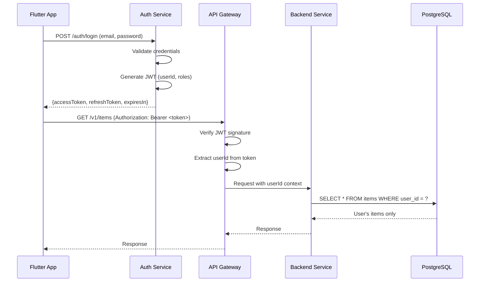
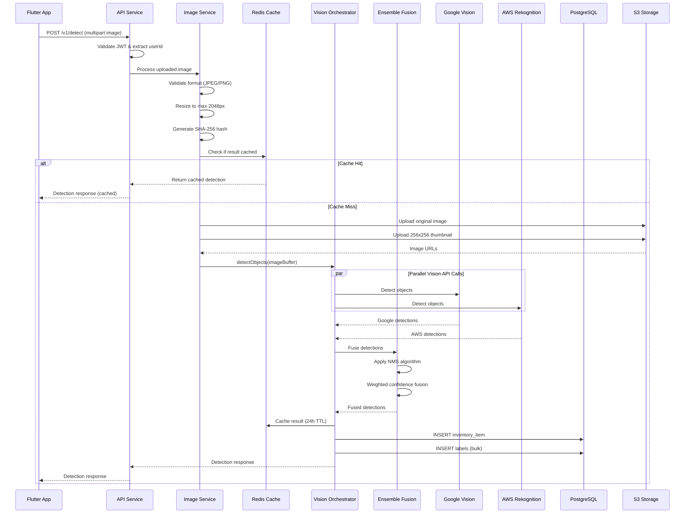
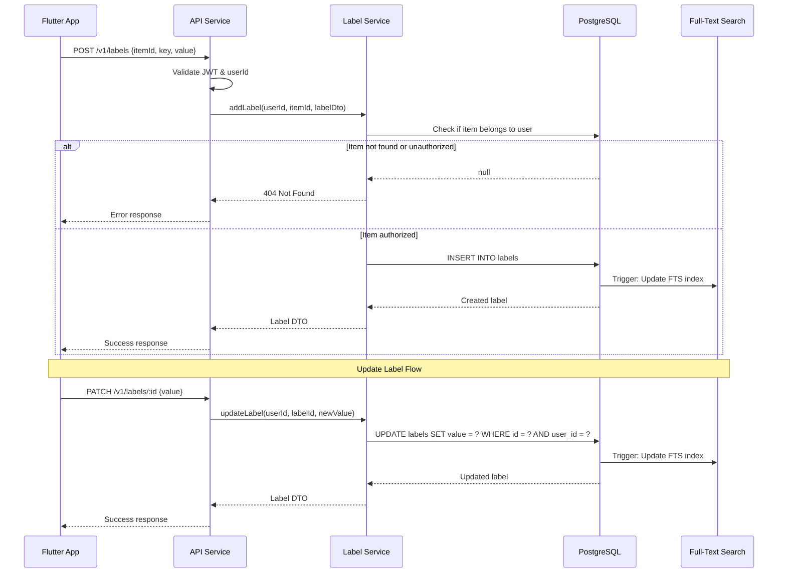
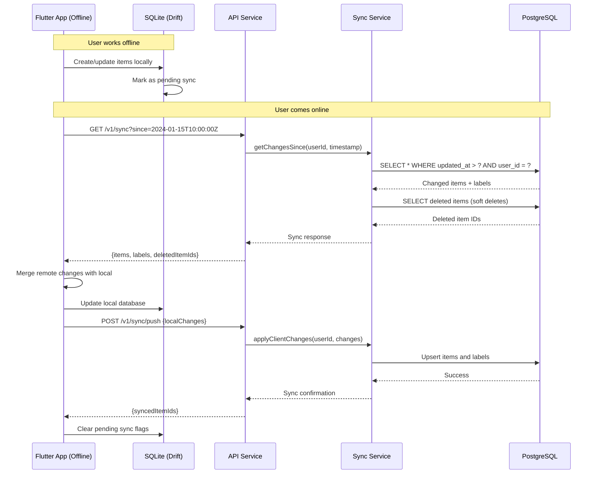
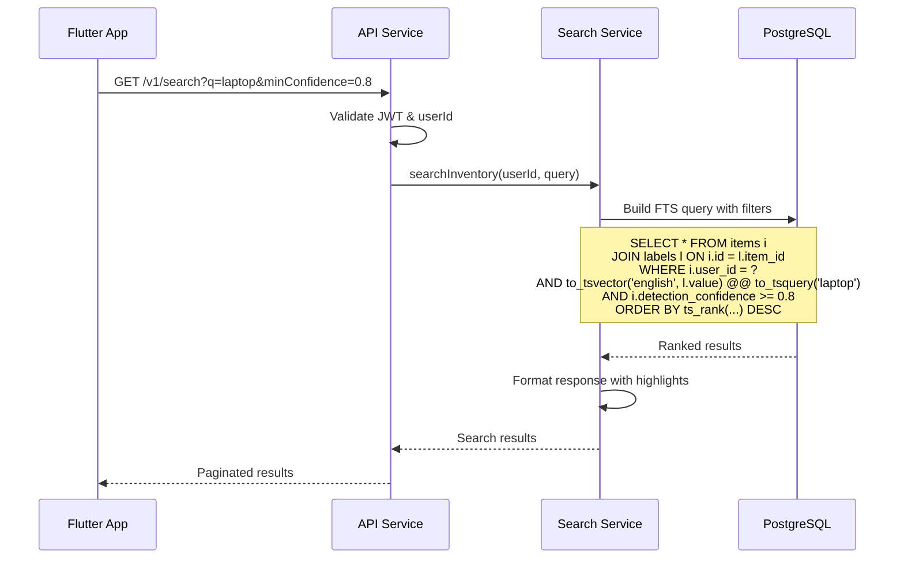
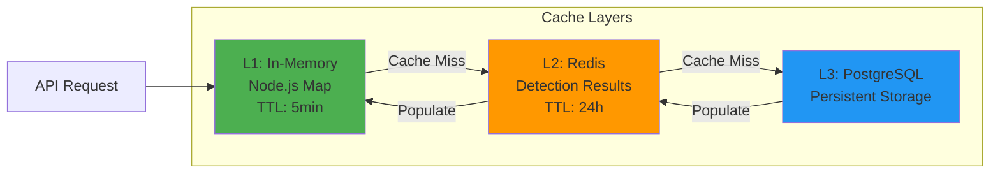

# Backend Service Architecture - Visual Home Inventory Manager

## Table of Contents
1. [System Overview](#system-overview)
2. [Service Architecture Diagram](#service-architecture-diagram)
3. [API Routes and Services](#api-routes-and-services)
4. [Authentication and Authorization](#authentication-and-authorization)
5. [Data Flow Diagrams](#data-flow-diagrams)
6. [Error Handling and Resilience](#error-handling-and-resilience)
7. [Caching Strategy](#caching-strategy)
8. [Technology Stack](#technology-stack)

---

## System Overview

The Visual Home Inventory Manager backend is built as a modular, layered architecture using Fastify and TypeScript. It orchestrates multiple computer vision providers through an ensemble pattern to deliver high-confidence object detection results.

### Core Capabilities
- Multi-provider vision AI orchestration (Google Vision, AWS Rekognition, Mock)
- Ensemble fusion for improved detection accuracy
- RESTful API for mobile Flutter app
- User-based data isolation
- Offline-first sync support
- Image processing and validation
- Circuit breaker pattern for resilience
- Redis-based caching for vision results

### Architecture Principles
1. **Separation of Concerns**: Clear boundaries between routes, services, adapters, and data layers
2. **Provider Abstraction**: All vision providers implement a common interface
3. **Resilience First**: Circuit breakers, timeouts, and retry logic built-in
4. **Stateless Design**: Horizontal scalability through stateless service design
5. **Contract-First**: OpenAPI specification drives API design
6. **User Isolation**: JWT-based authentication with user context propagation

---

## Service Architecture Diagram

```mermaid
graph TB
    subgraph "Mobile App Layer"
        FlutterApp[Flutter Mobile App]
    end

    subgraph "API Gateway Layer"
        APIGateway[API Gateway / Load Balancer]
        RateLimit[Rate Limiter]
        AuthMiddleware[Auth Middleware JWT]
    end

    subgraph "API Service Layer"
        FastifyApp[Fastify Application]

        subgraph "Routes"
            DetectRoute[/v1/detect POST]
            ItemsRoute[/v1/items GET/POST/PATCH/DELETE]
            LabelsRoute[/v1/labels GET/POST/PATCH/DELETE]
            SearchRoute[/v1/search GET]
            SyncRoute[/v1/sync GET]
            HealthRoute[/v1/health GET]
        end

        subgraph "Services"
            DetectionService[Detection Service]
            InventoryService[Inventory Service]
            LabelService[Label Service]
            SearchService[Search Service]
            SyncService[Sync Service]
            ImageService[Image Processing Service]
            VisionOrchestrator[Vision Orchestrator]
            EnsembleFusion[Ensemble Fusion Service]
        end

        subgraph "Adapters"
            GoogleAdapter[Google Vision Adapter]
            AWSAdapter[AWS Rekognition Adapter]
            MockAdapter[Mock Vision Adapter]
        end
    end

    subgraph "Resilience Layer"
        CircuitBreaker[Circuit Breaker]
        RetryLogic[Retry with Backoff]
    end

    subgraph "Caching Layer"
        Redis[(Redis Cache)]
    end

    subgraph "Data Layer"
        PostgreSQL[(PostgreSQL Database)]
        S3[S3 / Cloud Storage]
    end

    subgraph "External Services"
        GoogleVision[Google Cloud Vision API]
        AWSRekognition[AWS Rekognition API]
    end

    FlutterApp -->|HTTPS| APIGateway
    APIGateway --> RateLimit
    RateLimit --> AuthMiddleware
    AuthMiddleware --> FastifyApp

    DetectRoute --> DetectionService
    ItemsRoute --> InventoryService
    LabelsRoute --> LabelService
    SearchRoute --> SearchService
    SyncRoute --> SyncService

    DetectionService --> ImageService
    DetectionService --> VisionOrchestrator
    VisionOrchestrator --> EnsembleFusion

    VisionOrchestrator --> CircuitBreaker
    CircuitBreaker --> GoogleAdapter
    CircuitBreaker --> AWSAdapter
    CircuitBreaker --> MockAdapter

    GoogleAdapter --> RetryLogic
    AWSAdapter --> RetryLogic

    RetryLogic --> GoogleVision
    RetryLogic --> AWSRekognition

    DetectionService --> Redis
    InventoryService --> PostgreSQL
    LabelService --> PostgreSQL
    SearchService --> PostgreSQL
    SyncService --> PostgreSQL

    ImageService --> S3

    style FlutterApp fill:#4CAF50
    style FastifyApp fill:#2196F3
    style PostgreSQL fill:#FF9800
    style Redis fill:#F44336
    style GoogleVision fill:#9C27B0
    style AWSRekognition fill:#9C27B0
```

---

## API Routes and Services

### Route Structure

```
/v1/
├── detect              POST   - Detect objects in uploaded image
├── items
│   ├── GET            - List all inventory items (paginated)
│   ├── POST           - Create new inventory item
│   ├── /:id GET       - Get single item details
│   ├── /:id PATCH     - Update item metadata
│   └── /:id DELETE    - Delete item (soft delete)
├── labels
│   ├── POST           - Add custom label to item
│   ├── /:id PATCH     - Update label value
│   └── /:id DELETE    - Remove label
├── search
│   └── GET            - Full-text search across items/labels
├── sync
│   └── GET            - Get all changes since lastSyncTimestamp
└── health
    └── GET            - Health check + provider status
```

### Service Responsibilities

#### 1. Detection Service
**File**: `/src/services/detection.service.ts`

**Responsibilities**:
- Validate and process multipart file uploads
- Coordinate with Image Processing Service for resize/validation
- Call Vision Orchestrator for object detection
- Cache detection results in Redis
- Return formatted detection response

**Key Methods**:
```typescript
detectObjects(request: FastifyRequest, reply: FastifyReply): Promise<DetectionResponse>
processImageUpload(file: MultipartFile): Promise<Buffer>
validateImageFormat(buffer: Buffer): Promise<boolean>
cacheDetectionResult(imageHash: string, result: DetectionResponse): Promise<void>
```

#### 2. Inventory Service
**File**: `/src/services/inventory.service.ts`

**Responsibilities**:
- CRUD operations for inventory items
- Store detection metadata as JSON in database
- Associate labels with items
- Manage photo/thumbnail paths in S3
- User-based data isolation (WHERE user_id = ?)

**Key Methods**:
```typescript
createItem(userId: string, data: CreateItemDto): Promise<InventoryItemDto>
getItems(userId: string, pagination: PaginationDto): Promise<PaginatedResponse<InventoryItemDto>>
getItemById(userId: string, itemId: string): Promise<InventoryItemDto>
updateItem(userId: string, itemId: string, data: UpdateItemDto): Promise<InventoryItemDto>
deleteItem(userId: string, itemId: string): Promise<void>
```

#### 3. Label Service
**File**: `/src/services/label.service.ts`

**Responsibilities**:
- Add custom labels to inventory items
- Update label values (e.g., user corrections)
- Delete labels
- Validate label constraints (uniqueness, max length)
- Trigger FTS index updates

**Key Methods**:
```typescript
addLabel(userId: string, itemId: string, label: CreateLabelDto): Promise<LabelDto>
updateLabel(userId: string, labelId: string, value: string): Promise<LabelDto>
deleteLabel(userId: string, labelId: string): Promise<void>
getLabelsForItem(userId: string, itemId: string): Promise<LabelDto[]>
```

#### 4. Search Service
**File**: `/src/services/search.service.ts`

**Responsibilities**:
- Full-text search using PostgreSQL FTS (tsvector)
- Search across item labels and detection data
- Support filters (date range, confidence threshold)
- Ranked results by relevance

**Key Methods**:
```typescript
searchInventory(userId: string, query: SearchQueryDto): Promise<SearchResultDto[]>
buildSearchVector(labels: string[], detectionData: any): string
rankResults(results: any[], query: string): SearchResultDto[]
```

#### 5. Sync Service
**File**: `/src/services/sync.service.ts`

**Responsibilities**:
- Support offline-first mobile sync
- Return all items/labels modified since lastSyncTimestamp
- Include deleted items (soft deletes) for sync reconciliation
- Pagination for large sync datasets

**Key Methods**:
```typescript
getChangesSince(userId: string, timestamp: Date, pagination: PaginationDto): Promise<SyncResponseDto>
getDeletedItems(userId: string, since: Date): Promise<DeletedItemDto[]>
```

#### 6. Image Processing Service
**File**: `/src/services/image-processing.service.ts`

**Responsibilities**:
- Validate image format (JPEG, PNG, WebP)
- Resize images to max dimensions (prevent API abuse)
- Generate SHA-256 hash for cache keys
- Optimize images for vision API (compression)
- Upload to S3 with proper metadata

**Key Methods**:
```typescript
validateImage(buffer: Buffer): Promise<ValidationResult>
resizeImage(buffer: Buffer, maxDimension: number): Promise<Buffer>
generateImageHash(buffer: Buffer): string
uploadToS3(buffer: Buffer, userId: string, filename: string): Promise<S3UploadResult>
generateThumbnail(buffer: Buffer): Promise<Buffer>
```

#### 7. Vision Orchestrator Service
**File**: `/src/services/vision-orchestrator.service.ts` (existing)

**Enhancements**:
- Add circuit breaker per provider
- Add detection result caching
- Add provider health monitoring

#### 8. Ensemble Fusion Service
**File**: `/src/services/ensemble-fusion.service.ts` (existing)

**No changes required** - existing implementation is solid.

---

## Authentication and Authorization

### JWT-based Authentication Strategy



### Implementation Details

#### 1. Auth Middleware
**File**: `/src/middleware/auth.middleware.ts`

```typescript
interface JwtPayload {
  userId: string;
  email: string;
  roles: string[];
  iat: number;
  exp: number;
}

async function authMiddleware(
  request: FastifyRequest,
  reply: FastifyReply
): Promise<void> {
  try {
    // Extract token from Authorization header
    const authHeader = request.headers.authorization;
    if (!authHeader || !authHeader.startsWith('Bearer ')) {
      throw new UnauthorizedError('Missing or invalid authorization header');
    }

    const token = authHeader.substring(7);

    // Verify JWT signature and decode
    const decoded = jwt.verify(token, JWT_SECRET) as JwtPayload;

    // Check token expiration
    if (decoded.exp < Date.now() / 1000) {
      throw new UnauthorizedError('Token expired');
    }

    // Attach user context to request
    request.user = {
      userId: decoded.userId,
      email: decoded.email,
      roles: decoded.roles,
    };

  } catch (error) {
    if (error instanceof jwt.JsonWebTokenError) {
      throw new UnauthorizedError('Invalid token');
    }
    throw error;
  }
}
```

#### 2. User Context Propagation

All service methods accept `userId` as first parameter:

```typescript
// Service layer always receives userId
async function createItem(
  userId: string,  // Extracted from JWT
  data: CreateItemDto
): Promise<InventoryItemDto> {
  // All DB queries include user_id filter
  const item = await db.query(
    'INSERT INTO inventory_items (user_id, ...) VALUES (?, ...)',
    [userId, ...]
  );
  return item;
}
```

#### 3. Role-Based Access Control (RBAC)

```typescript
enum UserRole {
  USER = 'user',
  PREMIUM = 'premium',
  ADMIN = 'admin',
}

// Decorator for route-level permissions
function requireRole(role: UserRole) {
  return async (request: FastifyRequest, reply: FastifyReply) => {
    if (!request.user.roles.includes(role)) {
      throw new ForbiddenError('Insufficient permissions');
    }
  };
}

// Usage in routes
app.delete('/v1/items/:id', {
  preHandler: [authMiddleware, requireRole(UserRole.USER)],
  handler: deleteItemHandler,
});
```

#### 4. Rate Limiting per User

```typescript
// User-based rate limiting (stricter than global)
await app.register(rateLimit, {
  max: 50,  // 50 requests per user
  timeWindow: '1 minute',
  keyGenerator: (request) => request.user.userId,
  errorResponseBuilder: () => ({
    statusCode: 429,
    error: 'Too Many Requests',
    message: 'Rate limit exceeded. Please try again later.',
  }),
});
```

### Security Best Practices

1. **Token Storage**: Mobile app stores JWT in secure storage (Keychain/Keystore)
2. **HTTPS Only**: All API traffic over TLS 1.3
3. **Token Rotation**: Refresh tokens rotate every 7 days
4. **Short-lived Access Tokens**: 1 hour expiration
5. **Token Revocation**: Redis-based token blacklist for logout
6. **CORS Configuration**: Whitelist mobile app origins only
7. **Request Signing**: Optional HMAC signing for critical operations

---

## Data Flow Diagrams

### 1. Object Detection Flow



### 2. Label Management Flow



### 3. Offline Sync Flow



### 4. Search Flow



---

## Error Handling and Resilience

### Circuit Breaker Pattern

#### Implementation
**File**: `/src/utils/circuit-breaker.ts` (existing, enhanced)

```typescript
export class CircuitBreaker {
  private state: CircuitState = CircuitState.CLOSED;
  private failureCount = 0;
  private successCount = 0;
  private nextAttempt = Date.now();
  private lastFailureTime = 0;

  constructor(
    private readonly name: string,
    private readonly config: CircuitBreakerConfig
  ) {}

  async execute<T>(fn: () => Promise<T>): Promise<T> {
    if (this.state === CircuitState.OPEN) {
      if (Date.now() < this.nextAttempt) {
        throw new CircuitOpenError(
          `Circuit breaker [${this.name}] is OPEN`,
          this.nextAttempt
        );
      }
      this.state = CircuitState.HALF_OPEN;
      logger.info({ breaker: this.name }, 'Circuit breaker entering HALF-OPEN');
    }

    try {
      const result = await fn();
      this.onSuccess();
      return result;
    } catch (error) {
      this.onFailure();
      throw error;
    }
  }

  private onSuccess(): void {
    this.failureCount = 0;
    if (this.state === CircuitState.HALF_OPEN) {
      this.successCount++;
      if (this.successCount >= this.config.halfOpenRequests) {
        this.state = CircuitState.CLOSED;
        logger.info({ breaker: this.name }, 'Circuit breaker CLOSED');
      }
    }
  }

  private onFailure(): void {
    this.lastFailureTime = Date.now();
    this.failureCount++;

    if (this.failureCount >= this.config.failureThreshold) {
      this.state = CircuitState.OPEN;
      this.nextAttempt = Date.now() + this.config.resetTimeout;

      logger.error({
        breaker: this.name,
        failureCount: this.failureCount,
        nextAttempt: new Date(this.nextAttempt).toISOString(),
      }, 'Circuit breaker OPENED');

      // Emit metrics for monitoring
      metrics.circuitBreakerOpened(this.name);
    }
  }
}
```

#### Circuit Breaker Configuration per Provider

```typescript
const circuitBreakerConfig = {
  google: {
    failureThreshold: 5,      // Open after 5 consecutive failures
    resetTimeout: 30000,      // Try again after 30 seconds
    halfOpenRequests: 3,      // Need 3 successes to close
  },
  aws: {
    failureThreshold: 5,
    resetTimeout: 30000,
    halfOpenRequests: 3,
  },
};

// In VisionOrchestratorService constructor
this.circuitBreakers = {
  google: new CircuitBreaker('google-vision', circuitBreakerConfig.google),
  aws: new CircuitBreaker('aws-rekognition', circuitBreakerConfig.aws),
};
```

### Retry Logic with Exponential Backoff

```typescript
interface RetryConfig {
  maxAttempts: number;
  initialDelayMs: number;
  maxDelayMs: number;
  backoffMultiplier: number;
  retryableErrors: string[];
}

async function retryWithBackoff<T>(
  fn: () => Promise<T>,
  config: RetryConfig,
  context: string
): Promise<T> {
  let lastError: Error;

  for (let attempt = 1; attempt <= config.maxAttempts; attempt++) {
    try {
      return await fn();
    } catch (error) {
      lastError = error as Error;

      // Check if error is retryable
      const isRetryable = config.retryableErrors.some(
        (retryableError) => error.message.includes(retryableError)
      );

      if (!isRetryable || attempt === config.maxAttempts) {
        throw error;
      }

      // Calculate delay with exponential backoff + jitter
      const baseDelay = Math.min(
        config.initialDelayMs * Math.pow(config.backoffMultiplier, attempt - 1),
        config.maxDelayMs
      );
      const jitter = Math.random() * 0.3 * baseDelay;  // 30% jitter
      const delay = baseDelay + jitter;

      logger.warn({
        context,
        attempt,
        maxAttempts: config.maxAttempts,
        delayMs: Math.round(delay),
        error: error.message,
      }, 'Retrying failed request');

      await sleep(delay);
    }
  }

  throw lastError!;
}

// Usage in adapters
const retryConfig: RetryConfig = {
  maxAttempts: 3,
  initialDelayMs: 1000,
  maxDelayMs: 10000,
  backoffMultiplier: 2,
  retryableErrors: [
    'ECONNRESET',
    'ETIMEDOUT',
    'Rate limit exceeded',
    'Service unavailable',
  ],
};

async detectObjects(imageBuffer: Buffer): Promise<Detection[]> {
  return retryWithBackoff(
    () => this.client.labelDetection(imageBuffer),
    retryConfig,
    'google-vision-detect'
  );
}
```

### Error Response Format

All errors follow consistent structure:

```typescript
interface ErrorResponse {
  statusCode: number;
  error: string;
  message: string;
  timestamp: string;
  requestId: string;
  details?: any;
}

// Example error responses
{
  "statusCode": 400,
  "error": "Bad Request",
  "message": "Image format not supported. Accepted: JPEG, PNG, WebP",
  "timestamp": "2024-01-15T10:30:00.000Z",
  "requestId": "req_abc123def456"
}

{
  "statusCode": 503,
  "error": "Service Unavailable",
  "message": "Vision provider temporarily unavailable",
  "timestamp": "2024-01-15T10:30:00.000Z",
  "requestId": "req_abc123def456",
  "details": {
    "provider": "google-vision",
    "circuitState": "open",
    "retryAfter": "2024-01-15T10:30:30.000Z"
  }
}
```

### Timeout Management

```typescript
// Global timeout configuration
const TIMEOUTS = {
  visionProvider: 4000,      // 4s per provider
  database: 2000,            // 2s for DB queries
  s3Upload: 10000,           // 10s for S3 uploads
  apiRequest: 15000,         // 15s total request timeout
};

// Request-level timeout
app.addHook('onRequest', async (request, reply) => {
  const timeoutId = setTimeout(() => {
    reply.code(408).send({
      statusCode: 408,
      error: 'Request Timeout',
      message: 'Request processing exceeded maximum allowed time',
      timestamp: new Date().toISOString(),
      requestId: request.id,
    });
  }, TIMEOUTS.apiRequest);

  request.raw.on('close', () => clearTimeout(timeoutId));
});
```

### Graceful Degradation

When all vision providers fail:

```typescript
async detectObjects(imageBuffer: Buffer): Promise<DetectionResponse> {
  const providerResults = await Promise.allSettled(providerPromises);

  const successfulResults = providerResults.filter(
    (r) => r.status === 'fulfilled' && r.value.success
  );

  if (successfulResults.length === 0) {
    // Fallback: return empty detections with error context
    logger.warn('All vision providers failed, returning empty detections');

    return {
      success: false,
      ensembleMode: 'none',
      processingTimeMs: Date.now() - startTime,
      detections: [],
      providerResults: [],
      ensembleMetrics: {
        providersUsed: 0,
        averageConfidence: 0,
        consensusRate: 0,
      },
      error: 'All vision providers unavailable. Please try again later.',
    };
  }

  // Continue with available results...
}
```

---

## Caching Strategy

### Redis Cache Architecture



### Cache Keys and TTL Strategy

```typescript
// Cache key generation
function generateCacheKey(prefix: string, params: any): string {
  const hash = crypto
    .createHash('sha256')
    .update(JSON.stringify(params))
    .digest('hex')
    .substring(0, 16);

  return `${prefix}:${hash}`;
}

// Cache TTL configuration
const CACHE_TTL = {
  detectionResult: 24 * 60 * 60,      // 24 hours
  searchResults: 5 * 60,              // 5 minutes
  userItems: 10 * 60,                 // 10 minutes
  providerHealth: 60,                 // 1 minute
};

// Detection result caching
async function cacheDetectionResult(
  imageHash: string,
  result: DetectionResponse
): Promise<void> {
  const key = `detection:${imageHash}`;

  await redis.setex(
    key,
    CACHE_TTL.detectionResult,
    JSON.stringify(result)
  );

  logger.debug({ key, ttl: CACHE_TTL.detectionResult }, 'Cached detection result');
}

async function getCachedDetection(
  imageHash: string
): Promise<DetectionResponse | null> {
  const key = `detection:${imageHash}`;
  const cached = await redis.get(key);

  if (cached) {
    logger.debug({ key }, 'Detection cache hit');
    metrics.cacheHit('detection');
    return JSON.parse(cached);
  }

  metrics.cacheMiss('detection');
  return null;
}
```

### Cache Invalidation Strategies

#### 1. Time-based Expiration (TTL)
Default for most cached data. Redis handles automatic eviction.

#### 2. Event-driven Invalidation
Invalidate cache when data changes:

```typescript
// When user updates a label
async function updateLabel(
  userId: string,
  labelId: string,
  value: string
): Promise<LabelDto> {
  const updated = await db.updateLabel(labelId, value);

  // Invalidate related caches
  await Promise.all([
    redis.del(`user:${userId}:items`),          // User's item list
    redis.del(`search:${userId}:*`),            // Search results
    redis.del(`item:${updated.itemId}:labels`), // Item's labels
  ]);

  return updated;
}
```

#### 3. Cache Warming
Pre-populate cache for frequently accessed data:

```typescript
// Warm cache after user login
async function warmUserCache(userId: string): Promise<void> {
  const items = await db.getRecentItems(userId, 20);
  const key = `user:${userId}:recent`;

  await redis.setex(
    key,
    CACHE_TTL.userItems,
    JSON.stringify(items)
  );

  logger.debug({ userId }, 'Warmed user cache');
}
```

### Cache-Aside Pattern

```typescript
async function getItems(
  userId: string,
  pagination: PaginationDto
): Promise<PaginatedResponse<InventoryItemDto>> {
  const cacheKey = generateCacheKey('items', { userId, pagination });

  // Try cache first
  const cached = await redis.get(cacheKey);
  if (cached) {
    return JSON.parse(cached);
  }

  // Cache miss - query database
  const items = await db.getItems(userId, pagination);

  // Populate cache
  await redis.setex(
    cacheKey,
    CACHE_TTL.userItems,
    JSON.stringify(items)
  );

  return items;
}
```

### Redis Configuration

```typescript
import Redis from 'ioredis';

const redis = new Redis({
  host: process.env.REDIS_HOST || 'localhost',
  port: parseInt(process.env.REDIS_PORT || '6379'),
  password: process.env.REDIS_PASSWORD,
  db: 0,
  retryStrategy: (times) => {
    const delay = Math.min(times * 50, 2000);
    return delay;
  },
  maxRetriesPerRequest: 3,
  enableReadyCheck: true,
  lazyConnect: false,
});

// Health check
redis.on('connect', () => {
  logger.info('Redis connected');
});

redis.on('error', (error) => {
  logger.error({ error }, 'Redis connection error');
});
```

---

## Technology Stack

### Core Framework
- **Fastify 4.x**: High-performance web framework
- **TypeScript 5.x**: Type-safe development
- **Node.js 20 LTS**: Runtime environment

### Database & Storage
- **PostgreSQL 15**: Primary relational database
  - Full-text search with tsvector
  - JSONB for detection metadata
  - Indexes on user_id, updated_at
- **Redis 7**: Caching layer
  - Detection result cache
  - Session storage
  - Rate limiting counters
- **AWS S3 / CloudFlare R2**: Object storage
  - Original images
  - Thumbnails
  - Presigned URLs for mobile access

### Vision AI Providers
- **Google Cloud Vision API**: Primary provider
- **AWS Rekognition**: Secondary provider
- **Mock Provider**: Development/testing

### Authentication & Security
- **jsonwebtoken**: JWT generation/validation
- **bcrypt**: Password hashing
- **helmet**: Security headers
- **@fastify/rate-limit**: DDoS protection

### Monitoring & Observability
- **Pino**: Structured logging
- **OpenTelemetry**: Distributed tracing
- **Prometheus**: Metrics collection
- **Grafana**: Dashboards

### Testing
- **Vitest**: Unit testing
- **Supertest**: Integration testing
- **@faker-js/faker**: Test data generation

### Deployment
- **Docker**: Containerization
- **Kubernetes**: Orchestration
- **GitHub Actions**: CI/CD

---

## Next Steps

1. Review OpenAPI specification (see `OPENAPI.yaml`)
2. Review detailed implementation plan (see `IMPLEMENTATION_PLAN.md`)
3. Set up PostgreSQL schema (see `schema.sql`)
4. Configure environment variables
5. Implement authentication service
6. Begin service implementation following layered architecture
