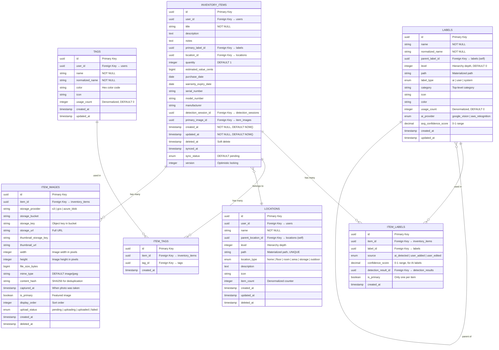
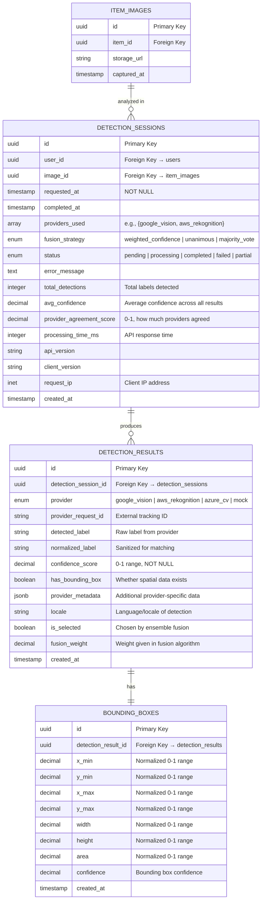
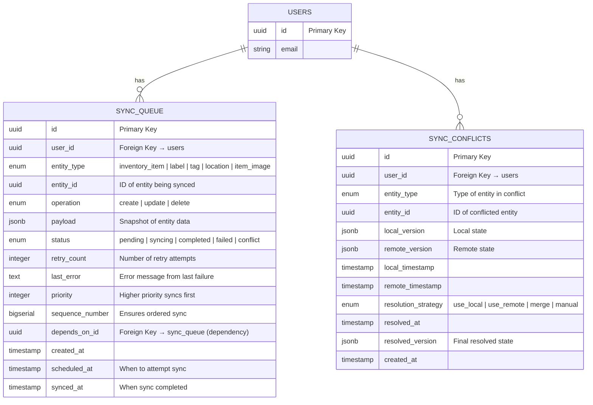
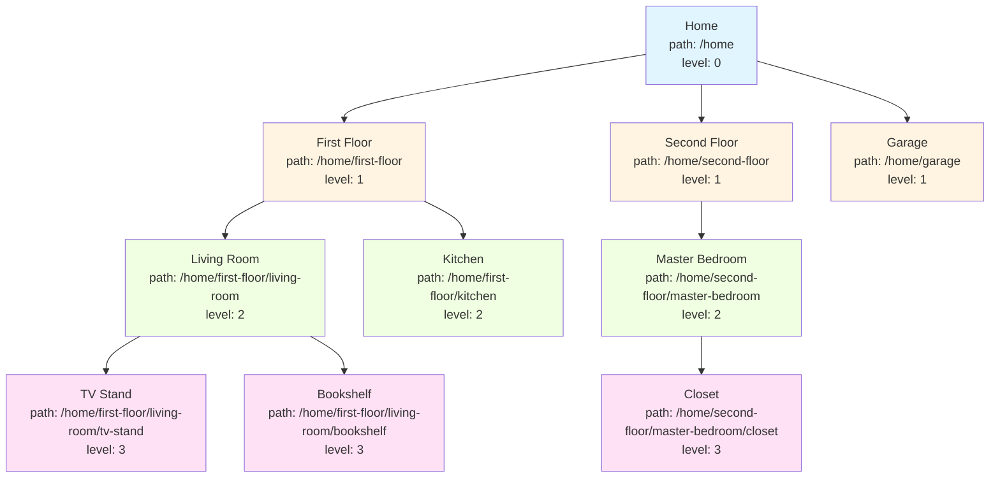
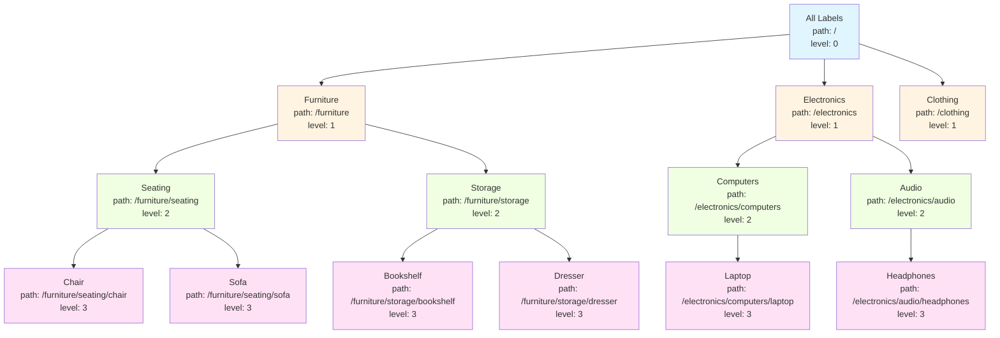
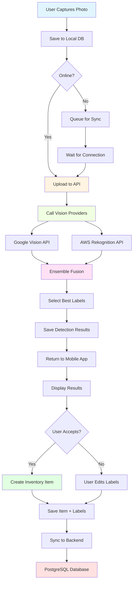
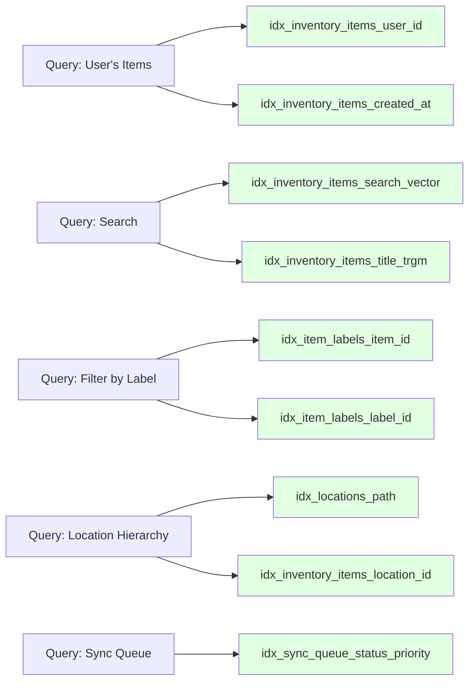
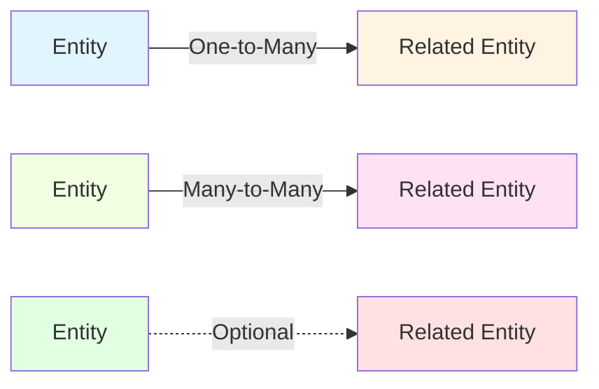

# Entity Relationship Diagram - Visual Home Inventory Manager

## Overview

This document contains the Entity-Relationship Diagram (ERD) for the Visual Home Inventory Manager database schema, showing entities, relationships, and key attributes.

---

## Complete ERD (High-Level)

```mermaid
erDiagram
    USERS ||--o{ INVENTORY_ITEMS : owns
    USERS ||--o{ TAGS : creates
    USERS ||--o{ LOCATIONS : defines
    USERS ||--o{ DETECTION_SESSIONS : initiates
    USERS ||--o{ SYNC_QUEUE : has
    USERS ||--|| USER_PREFERENCES : has

    INVENTORY_ITEMS ||--o{ ITEM_LABELS : has
    INVENTORY_ITEMS ||--o{ ITEM_TAGS : has
    INVENTORY_ITEMS }o--|| LOCATIONS : "located in"
    INVENTORY_ITEMS }o--|| LABELS : "primary label"
    INVENTORY_ITEMS ||--o{ ITEM_IMAGES : has
    INVENTORY_ITEMS }o--|| DETECTION_SESSIONS : "detected by"

    LABELS ||--o{ ITEM_LABELS : "applied to"
    LABELS ||--o{ LABELS : "parent of"

    TAGS ||--o{ ITEM_TAGS : "tagged on"

    LOCATIONS ||--o{ LOCATIONS : "contains"

    ITEM_IMAGES ||--|| IMAGE_METADATA : has
    ITEM_IMAGES ||--o{ DETECTION_SESSIONS : "analyzed in"

    DETECTION_SESSIONS ||--o{ DETECTION_RESULTS : produces
    DETECTION_RESULTS ||--|| BOUNDING_BOXES : has

    USERS {
        uuid id PK
        string email UK
        string auth_provider_id UK
        string display_name
        timestamp created_at
        timestamp last_synced_at
    }

    INVENTORY_ITEMS {
        uuid id PK
        uuid user_id FK
        string title
        text description
        uuid primary_label_id FK
        uuid location_id FK
        integer quantity
        bigint estimated_value_cents
        date purchase_date
        date warranty_expiry_date
        timestamp created_at
        timestamp deleted_at
        integer version
    }

    LABELS {
        uuid id PK
        string name
        string normalized_name UK
        uuid parent_label_id FK
        integer level
        string path
        enum label_type
        string category
        integer usage_count
        decimal avg_confidence_score
    }

    TAGS {
        uuid id PK
        uuid user_id FK
        string name
        string normalized_name UK
        string color
        integer usage_count
    }

    LOCATIONS {
        uuid id PK
        uuid user_id FK
        string name
        uuid parent_location_id FK
        integer level
        string path UK
        enum location_type
        integer item_count
    }

    ITEM_LABELS {
        uuid id PK
        uuid item_id FK
        uuid label_id FK
        enum source
        decimal confidence_score
        boolean is_primary
    }

    ITEM_TAGS {
        uuid id PK
        uuid item_id FK
        uuid tag_id FK
    }

    ITEM_IMAGES {
        uuid id PK
        uuid item_id FK
        string storage_key
        string storage_url
        integer width
        integer height
        bigint file_size_bytes
        timestamp captured_at
        boolean is_primary
        enum upload_status
    }

    IMAGE_METADATA {
        uuid id PK
        uuid image_id FK
        string camera_make
        string camera_model
        jsonb exif_data
        decimal gps_latitude
        decimal gps_longitude
    }

    DETECTION_SESSIONS {
        uuid id PK
        uuid user_id FK
        uuid image_id FK
        array providers_used
        enum fusion_strategy
        enum status
        integer total_detections
        decimal avg_confidence
        decimal provider_agreement_score
        integer processing_time_ms
    }

    DETECTION_RESULTS {
        uuid id PK
        uuid detection_session_id FK
        enum provider
        string detected_label
        string normalized_label
        decimal confidence_score
        boolean has_bounding_box
        boolean is_selected
        jsonb provider_metadata
    }

    BOUNDING_BOXES {
        uuid id PK
        uuid detection_result_id FK
        decimal x_min
        decimal y_min
        decimal x_max
        decimal y_max
        decimal width
        decimal height
        decimal area
    }

    SYNC_QUEUE {
        uuid id PK
        uuid user_id FK
        enum entity_type
        uuid entity_id
        enum operation
        jsonb payload
        enum status
        integer priority
        bigserial sequence_number
    }

    USER_PREFERENCES {
        uuid id PK
        uuid user_id FK UK
        jsonb preferences
    }
```

---

## Core Inventory ERD (Detailed)



---

## Detection & AI Processing ERD



---

## Synchronization & Offline Support ERD



---

## Hierarchical Data Structure (Locations)



**Query Example**:
```sql
-- Get all items in "Living Room" and its sub-locations
SELECT i.*
FROM inventory_items i
JOIN locations l ON i.location_id = l.id
WHERE l.path LIKE '/home/first-floor/living-room%';
```

---

## Label Hierarchy Example (Taxonomy)



---

## Data Flow Diagram



---

## Cardinality Summary

| Relationship | Cardinality | Description |
|--------------|-------------|-------------|
| Users → Inventory Items | 1:M | User owns many items |
| Items → Labels | M:M | Item can have multiple labels |
| Items → Tags | M:M | Item can have multiple tags |
| Items → Location | M:1 | Item belongs to one location |
| Items → Images | 1:M | Item has multiple photos |
| Images → Detection Sessions | 1:M | Image analyzed multiple times |
| Session → Results | 1:M | Session produces many results |
| Result → Bounding Box | 1:1 | Result has optional bbox |
| Labels → Labels | 1:M | Parent-child hierarchy |
| Locations → Locations | 1:M | Parent-child hierarchy |

---

## Index Coverage Visualization



---

## Normalization Analysis

### Fully Normalized (3NF)

- **inventory_items**: No repeating groups, atomic values
- **labels**: Normalized taxonomy, no duplication
- **tags**: Unique per user, normalized

### Selective Denormalization (Performance)

| Field | Denormalized In | Reason |
|-------|----------------|--------|
| `usage_count` | labels, tags | Avoid COUNT(*) queries for sorting |
| `item_count` | locations | Dashboard performance |
| `avg_confidence` | detection_sessions | Avoid aggregation on read |
| `total_items` | users | Dashboard statistics |
| `search_vector` | inventory_items (PG) | Full-text search performance |

**Trade-off**: Faster reads, slightly more complex writes (managed via triggers)

---

## Constraint Summary

### Primary Keys
- All tables use `uuid` (mobile) or `UUID` (backend) primary keys
- UUIDs enable distributed ID generation (no central sequence)

### Foreign Keys
- All relationships enforced via foreign key constraints
- `ON DELETE CASCADE` for owned entities (items → images)
- `ON DELETE SET NULL` for optional references (items → labels)

### Unique Constraints
- `users.email` - One account per email
- `tags(user_id, normalized_name)` - Unique tag names per user
- `locations(user_id, path)` - Unique location paths per user
- `item_labels(item_id, label_id)` - No duplicate labels on item

### Check Constraints
- `inventory_items.quantity > 0` - Must have at least 1
- `confidence_score BETWEEN 0 AND 1` - Valid confidence range
- `x_min, y_min, x_max, y_max BETWEEN 0 AND 1` - Normalized coordinates

---

## Legend



**Notation**:
- `||--o{` - One-to-Many (1:M)
- `}o--||` - Many-to-One (M:1)
- `||--||` - One-to-One (1:1)
- `}o--o{` - Many-to-Many (M:M)

---

This ERD provides a complete visual representation of the database architecture for the Visual Home Inventory Manager application.
